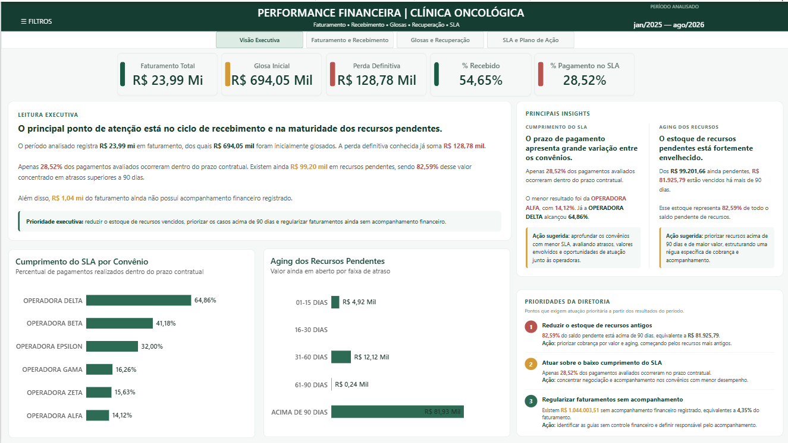
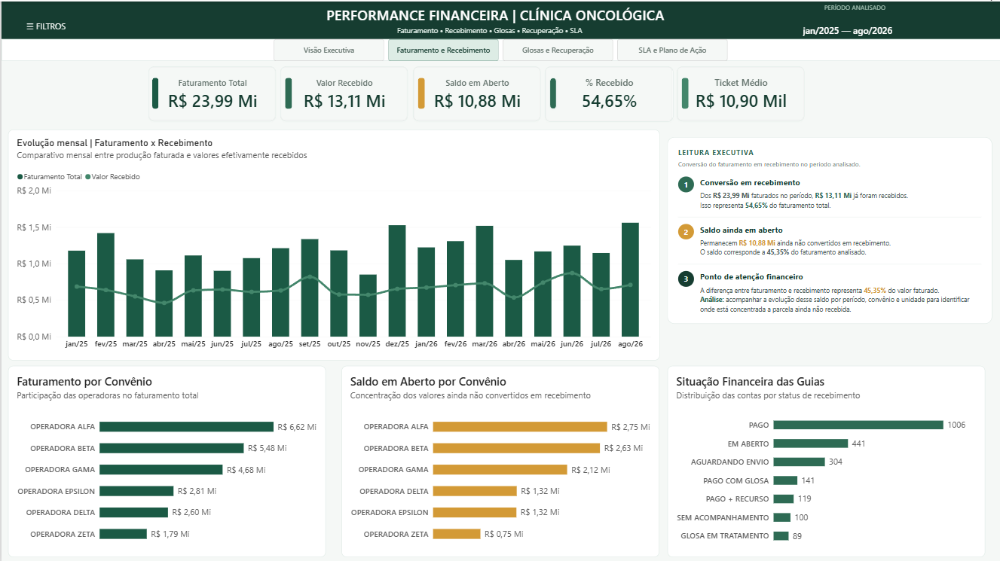
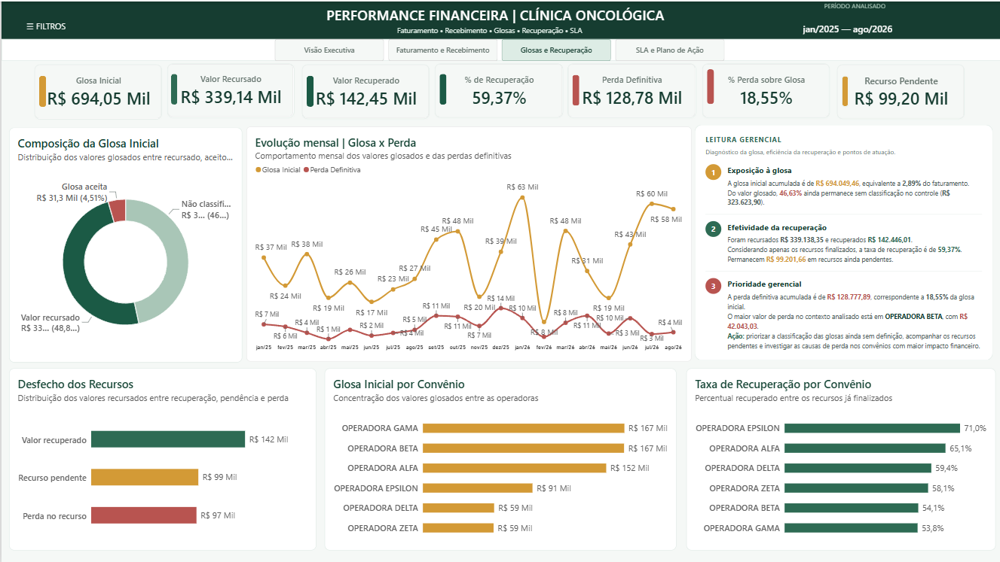
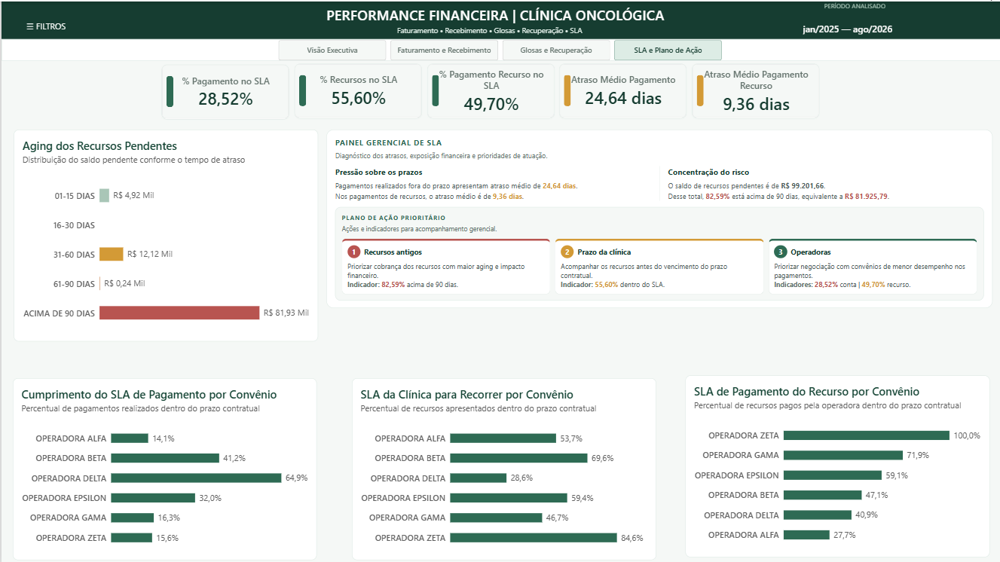
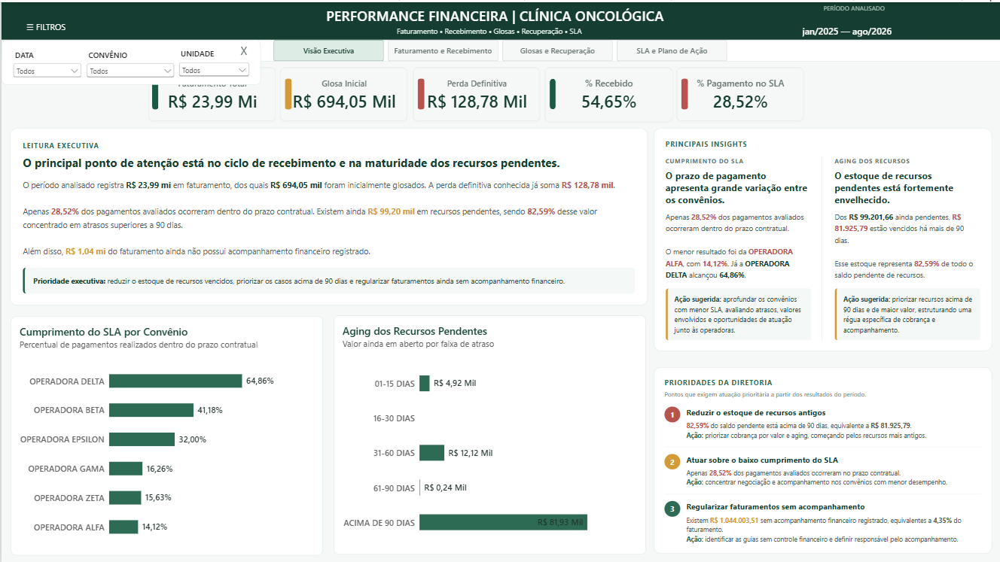

# Performance Financeira | Clínica Oncológica

Projeto de portfólio desenvolvido para simular a análise financeira do faturamento de uma clínica oncológica, integrando **Python, Pandas, Power BI, Power Query e DAX**.

O objetivo foi transformar bases operacionais de faturamento, recebimentos, glosas e recursos em um painel gerencial capaz de responder às principais perguntas da diretoria sobre **receita, recebimento, perdas, recuperação financeira, aging e cumprimento de SLA**.

> **Observação:** os dados, operadoras, unidades, valores e prazos utilizados neste projeto são fictícios e foram preparados exclusivamente para fins de portfólio.

---

## Objetivos do projeto

O dashboard foi desenvolvido para responder perguntas como:

- Quanto foi faturado e quanto já foi efetivamente recebido?
- Qual é o saldo ainda em aberto?
- Onde o saldo em aberto está concentrado?
- Quanto do faturamento foi glosado?
- Quanto foi recuperado após recurso?
- Qual parcela das glosas já se tornou perda definitiva?
- Quais operadoras concentram maior volume de glosa?
- Quais apresentam melhores taxas de recuperação?
- Os pagamentos estão ocorrendo dentro dos prazos contratuais?
- A clínica está apresentando os recursos dentro do SLA?
- Quanto dos recursos pendentes está concentrado em aging elevado?
- Quais pontos devem receber prioridade gerencial?

---

## Principais resultados

No período analisado, o projeto identificou:

- **Faturamento total:** R$ 23,99 milhões
- **Valor recebido:** R$ 13,11 milhões
- **Saldo em aberto:** R$ 10,88 milhões
- **Percentual recebido:** 54,65%
- **Glosa inicial:** R$ 694,05 mil
- **Perda definitiva:** R$ 128,78 mil
- **Valor recuperado após recurso:** R$ 142,45 mil
- **Taxa de recuperação dos recursos finalizados:** 59,37%
- **Recurso pendente:** R$ 99,20 mil
- **Saldo pendente acima de 90 dias:** 82,59%
- **Pagamentos realizados dentro do SLA:** 28,52%

Além da mensuração dos indicadores, o dashboard apresenta **leituras executivas, insights e planos de ação** para apoiar a priorização gerencial.

---

## Estrutura do dashboard

### 1. Visão Executiva

Consolida os principais KPIs e apresenta uma leitura gerencial do período, destacando os pontos de maior atenção para a diretoria.

Principais análises:

- Faturamento total
- Glosa inicial
- Perda definitiva
- Percentual recebido
- Cumprimento do SLA de pagamento
- Aging dos recursos pendentes
- Principais insights
- Prioridades da diretoria



---

### 2. Faturamento e Recebimento

Analisa a conversão do faturamento em recebimento e identifica onde o saldo ainda não recebido está concentrado.

Principais análises:

- Faturamento total
- Valor recebido
- Saldo em aberto
- Percentual recebido
- Ticket médio
- Evolução mensal de faturamento x recebimento
- Faturamento por convênio
- Saldo em aberto por convênio
- Situação financeira das guias
- Leitura executiva



---

### 3. Glosas e Recuperação

Acompanha a origem, tratamento e desfecho financeiro das glosas.

Principais análises:

- Glosa inicial
- Valor recursado
- Valor recuperado
- Taxa de recuperação
- Perda definitiva
- Percentual de perda sobre glosa
- Recurso pendente
- Composição da glosa
- Evolução mensal de glosa x perda
- Desfecho dos recursos
- Glosa por convênio
- Taxa de recuperação por convênio
- Leitura gerencial



---

### 4. SLA e Plano de Ação

Avalia o cumprimento dos prazos contratuais e transforma os principais riscos identificados em prioridades de acompanhamento.

Principais análises:

- Percentual de pagamentos dentro do SLA
- Percentual de recursos apresentados dentro do SLA
- Percentual de pagamentos de recurso dentro do SLA
- Atraso médio dos pagamentos
- Atraso médio no pagamento dos recursos
- Aging dos recursos pendentes
- SLA por convênio
- Diagnóstico gerencial
- Plano de ação prioritário



---

## Filtros e interatividade

O relatório possui filtros retráteis de:

- Data
- Convênio
- Unidade

Os filtros foram configurados de forma independente em cada página, permitindo que o usuário explore diferentes cenários sem obrigatoriamente carregar o mesmo contexto para todo o relatório.



---

## Regras de negócio relevantes

Algumas decisões de negócio foram fundamentais para evitar interpretações incorretas:

- **Glosa aceita/desconsiderada:** valor glosado pela operadora que a clínica aceita e não recorre. É tratado como perda.
- **Perda no recurso:** diferença entre o valor recursado e o valor efetivamente recuperado após o recurso.
- **Perda definitiva:** soma das perdas já conhecidas após o tratamento das glosas.
- **Recursos sem desfecho:** permanecem classificados como pendentes até que exista uma conclusão.
- **Guias sem registro financeiro:** são classificadas como **SEM ACOMPANHAMENTO**, evitando interpretar ausência de informação como valor zero.
- **Taxa de recuperação:** calculada sobre os recursos finalizados, para não distorcer o indicador com recursos ainda pendentes.

---

## Processo de preparação dos dados

A construção do projeto foi dividida em etapas:

1. Exploração das bases
2. Limpeza e padronização
3. Tratamento de duplicidades
4. Padronização de convênios
5. Integração das bases pela chave `NR_GUIA`
6. Construção das regras de glosa e recuperação
7. Cálculo dos SLAs
8. Construção do aging
9. Validação financeira
10. Geração da base analítica final
11. Modelagem no Power BI
12. Criação de medidas DAX
13. Construção do dashboard e storytelling executivo

A base analítica final ficou com:

- **2.200 registros**
- **2.200 guias únicas**
- **0 duplicidades**
- **65 colunas**

---

## Tecnologias utilizadas

- **Python**
- **Pandas**
- **Excel**
- **Power BI**
- **Power Query**
- **DAX**
- **HTML Content**
- **Git**
- **GitHub**

---

## Estrutura sugerida do repositório

```text
analise-financeira-clinica-oncologica/
│
├── data/
│   ├── raw/
│   └── processed/
│
├── scripts/
│   ├── 01_exploracao.py
│   ├── 02_exploracao_recebimentos.py
│   ├── 03_integracao.py
│   └── 04_validacao_final.py
│
├── powerbi/
│   └── Performance_financeira.pbix
│
├── assets/
│   ├── 01_visao_executiva.png
│   ├── 02_faturamento_recebimento.png
│   ├── 03_glosas_recuperacao.png
│   ├── 04_sla_plano_acao.png
│   └── 05_filtros_interacao.png
│
├── README.md
└── .gitignore
```

---

## Competências demonstradas

Este projeto demonstra aplicação prática de:

- Análise exploratória de dados
- Limpeza e transformação de dados
- Integração de múltiplas fontes
- Construção de regras de negócio
- Validação de indicadores financeiros
- Modelagem analítica
- Desenvolvimento de medidas DAX
- Criação de KPIs
- Storytelling com dados
- Design de dashboard executivo
- Análise de aging
- Análise de SLA
- Análise de glosas e recuperação financeira
- Identificação de riscos e oportunidades de atuação

---

## Conclusão

O projeto foi desenvolvido com foco em transformar dados operacionais em **informação gerencial acionável**.

Mais do que apresentar indicadores, o dashboard busca conectar:

**resultado financeiro → causa potencial → risco → prioridade → ação gerencial**

Esse fluxo permite que o relatório funcione como uma ferramenta de apoio à tomada de decisão, e não apenas como uma coleção de gráficos.

---

## Autora

**Stefany Vianna**

Projeto desenvolvido para portfólio profissional em Análise de Dados.
